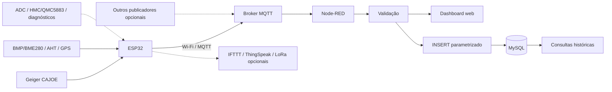

# ESP32 Radiation and Sensors

Estação IoT para monitorização da radiação e de sensores ambientais, aquisição
contínua num ESP32, transmissão MQTT, visualização em Node-RED e armazenamento
histórico em MySQL.

## Arquitetura



O MQTT desacopla a estação de aquisição do servidor. O Node-RED recebe,
valida e encaminha cada observação para o dashboard e para a base de dados.
O dashboard mostra dados recebidos em tempo real; o MySQL guarda o histórico.
O fluxo não recarrega automaticamente o histórico MySQL no dashboard.

## Conteúdo do repositório

| Caminho | Finalidade |
|---|---|
| [firmware/ArduinoGeigerCounterMix/](firmware/ArduinoGeigerCounterMix/) | Firmware ESP32 V1.7.0 (deteção automática e estatísticas Geiger) |
| [HardwareConfig.h](firmware/ArduinoGeigerCounterMix/HardwareConfig.h) | Seleção dos módulos instalados, ecrã e GPIOs |
| [credentials.example.h](firmware/ArduinoGeigerCounterMix/credentials.example.h) | Modelo de configuração, sem credenciais reais |
| [ExtraSensors.h](firmware/ArduinoGeigerCounterMix/ExtraSensors.h) | Aquisição e publicação dos módulos adicionais |
| [node-red/flows.json](node-red/flows.json) | 4 separadores, 32 gráficos, 18 textos e 38 tópicos MQTT |
| [database/schema.sql](database/schema.sql) | Criação da base de dados e das 20 tabelas |
| [database/queries.sql](database/queries.sql) | Exemplos de consultas históricas |
| [docs/architecture.md](docs/architecture.md) | Ligações, tópicos, tabelas e frequência |
| [docs/arduino-ide.md](docs/arduino-ide.md) | Exemplo de configuração Arduino IDE, bibliotecas e perfis de sensores |
| [docs/geiger-v16.md](docs/geiger-v16.md) | Estatísticas Geiger, CAJOE/J305, novos flows e migração da V1.5.0 |
| [docs/hardware-v17.md](docs/hardware-v17.md) | Perfil da estação CAJOE, identificação I²C e calibração do magnetómetro |
| [pi_setup/](pi_setup/) | Instalador/atualizador Python para Raspberry Pi com backup e migração seletiva |
| [docs/raspberry-pi-setup.md](docs/raspberry-pi-setup.md) | Instruções de atualização automática do backend |
| [tests/validate-flow.js](tests/validate-flow.js) | Testes locais do fluxo e do contrato SQL |
| [tests/firmware/](tests/firmware/) | Testes do firmware com interfaces simuladas (sem ESP32) |

## Instalação

Para uma instalação Raspberry Pi existente, consultar o [instalador Python](docs/raspberry-pi-setup.md).
Começar pelo modo `plan`, que não altera ficheiros, base de dados nem serviços.

### 1. ESP32

Consultar o [guia Arduino IDE](docs/arduino-ide.md) para reproduzir a configuração
WEMOS LOLIN32 Lite com o core ESP32 2.0.16, instalar as bibliotecas e selecionar
os módulos físicos da estação.

1. Abrir `firmware/ArduinoGeigerCounterMix/ArduinoGeigerCounterMix.ino` no Arduino IDE.
2. Instalar o suporte de placas Arduino-ESP32 2.0.16 e as seis bibliotecas
   do perfil predefinido: **PubSubClient**, **Adafruit BMP280 Library**,
   **Adafruit BME280 Library**, **Adafruit Unified Sensor**, **Adafruit BusIO**
   e **TinyGPSPlus**. Se `ENABLE_LORA=1`, é também obrigatória a biblioteca
   **LoRa (Sandeep Mistry)**. O OLED (ThingPulse), IFTTTWebhook e ThingSpeak
   só são necessários quando os respetivos módulos estão ativados. Consultar
   a [checklist completa e resolução de erros](docs/arduino-ide.md#3-bibliotecas-arduino-necessárias).
   AHT10/AHT20 e HMC5883L/QMC5883L utilizam o driver I²C integrado.
3. Copiar `credentials.example.h` para `credentials.h`. Preencher o SSID,
   a palavra-passe, endereço e porta do broker MQTT. Ativar serviços externos
   apenas se forem configurados no HardwareConfig.h.
4. Confirmar o modelo de placa, as ligações e a tensão dos sinais antes de
   compilar e carregar. A V1.7.0 preserva as ligações da versão esp32_v6: GPIO13 para
   Geiger, GPIO21/22 para I²C, GPIO16/17 para GPS, GPIO34 para ADC.
   O LED está desativado porque GPIO22 é agora SCL.
5. Abrir o monitor série a 115200 baud.

### Configuração modular do hardware

Editar apenas [HardwareConfig.h](firmware/ArduinoGeigerCounterMix/HardwareConfig.h)
e recompilar/carregar o firmware. Cada opção aceita 1 (ativado) ou 0 (desativado).

| Opção | Predefinição | Efeito de desligar |
|---|---:|---|
| STATION_PROFILE | 1 | 0 = perfil genérico V1.6, sem deteção BME, magnetómetro e diagnósticos internos por defeito |
| ENABLE_GEIGER | 1 | Sem interrupção Geiger, CPM, CPH nem alertas de radiação |
| ENABLE_BMP280 | 1 | Sem acesso ao barómetro BMP/BME nem publicação de temperatura, pressão e altitude |
| ENABLE_BME280 | 1 | Sem suporte BME280; BMP280 continua disponível |
| ENABLE_LCD | 0 | Sem inicialização nem biblioteca OLED |
| ENABLE_LED | 0 | Sem configurar o GPIO nem subscrever comandos do LED |
| ENABLE_AHT | 1 | Sem humidade/temperatura AHT10/AHT20 |
| ENABLE_GPS | 1 | Sem UART GPS nem coordenadas |
| ENABLE_NTP | 1 | Sem publicação do timestamp UTC sincronizado |
| ENABLE_VOLTAGE | 0 | Sem ADC (requer divisor e calibração confirmados) |
| ENABLE_MAG | 1 | Sem magnetómetro HMC5883L/QMC5883L |
| ENABLE_MAG_CAL_LOG | 0 | Sem registo série rápido de amostras brutas para calibração |
| ENABLE_LORA | 0 | Sem emissor LoRa (requer frequência, antena e recetor confirmados) |
| ENABLE_HALL | 1 | Sem Hall interno (apenas ESP32 clássico + core 2.x) |
| ENABLE_INTTEMP | 1 | Sem diagnóstico da temperatura interna |
| ENABLE_IFTTT | 0 | Sem alertas HTTP |
| ENABLE_THINGSPEAK | 0 | Sem publicação ThingSpeak |
| ENABLE_DOSE_ESTIMATE | 0 | Sem estimativa indicativa de dose (J305; não calibrada) |

O I²C só é inicializado quando BMP280, AHT, magnetómetro ou OLED está ativado. O Geiger
desativado também desativa os dependentes IFTTT/ThingSpeak.
Se BMP/BME280, AHT, HMC/QMC5883L ou OLED estiver ativado mas não responder,
assinala-se unavailable e tenta-se novamente periodicamente. Sem comunicação física
de diagnóstico, o Geiger não consegue distinguir uma remoção de um período
sem impulsos: desativá-lo explicitamente se for retirado.
O OLED pode mostrar CPM, ou temperatura se apenas o BMP280 estiver ativo.

As flags não são comandos de rede; requerem recompilação. Valores antigos
das flags em credentials.h têm precedência por compatibilidade: removê-los
desse ficheiro para gerir tudo pelo HardwareConfig.h.
Para quem usava IFTTT na V1.4.0, ativar ENABLE_IFTTT=1 com as credenciais válidas.
O dashboard indica o estado dos módulos, sem guardar os estados nas tabelas
numéricas. Um histórico antigo pode continuar visível no gráfico até sair
da janela temporal; não são inseridos zeros artificiais. O firmware
rejeita conflitos entre GPIOs de módulos ativos durante a compilação.

### Recuperação da versão esp32_v6

- GPS lê a UART continuamente e utiliza seis casas decimais, somente
  com fix recente válido. Ausência de dados e falta de fix são distintas.
- NTP em segundo plano, UTC ISO 8601 com Z; sem publicar um relógio
  ainda não sincronizado.
- AHT: leitura I²C com verificações de comprimento e prazo limitado,
  sem esperas infinitas se o módulo estiver ausente.
- ADC: média de 16 leituras em milivolts, ganho/offset configuráveis
  (v6: 2 e 0,42 V, valores provisórios), não ativar sem verificar o divisor
  resistivo e a tensão admissível na entrada GPIO34.
- HMC5883L/QMC5883L: identifica a variante, valida os dados e aceita eixos zero.
  Orientação é aproximada, necessita nivelamento, calibração e declinação local.
- LoRa: inicialização e envio assíncrono; não encerra SPI após cada envio.
  Apenas emissor de diagnóstico/CPM. Para entregar dados ao Node-RED
  por rádio é necessário um recetor/gateway, não incluído.
- Hall: estado unsupported no core Arduino-ESP32 3.x, onde hallRead foi
  removido; a temperatura interna é diagnóstica, não temperatura ambiental.

### 2. Broker MQTT

Disponibilizar um broker compatível com MQTT 3.1.1 (por exemplo Eclipse
Mosquitto) acessível ao ESP32 e ao Node-RED. Configurar o mesmo endpoint,
porta, autenticação e prefixo de tópicos nos dois clientes. A porta TCP em
exemplo é 1883; a instalação real pode utilizar outra porta.

O firmware usa `esp32/` por defeito. O fluxo espera esse prefixo. Se for
alterado, atualizar todos os tópicos correspondentes no Node-RED.

### 3. MySQL

Criar o esquema de raiz numa instância MySQL ou MariaDB compatível:

```sh
mysql -u ADMIN -p < database/schema.sql
```

Criar separadamente um utilizador dedicado para o Node-RED com privilégios
mínimos (INSERT nas tabelas do esquema; SELECT apenas se forem necessárias
consultas históricas). Nunca executar o Node-RED como administrador MySQL.
Em instalações já existentes, fazer backup e verificar as definições das
tabelas antes de aplicar o esquema: CREATE IF NOT EXISTS não as migra.

### 4. Node-RED

No diretório de utilizador do Node-RED, normalmente `~/.node-red`, instalar
os módulos do fluxo enviado:

```sh
npm install node-red-contrib-stackhero-mysql node-red-dashboard
```

Reiniciar o Node-RED, abrir o editor (normalmente
`http://localhost:1880`), importar [flows.json](node-red/flows.json) e
configurar os dois nós de configuração MQTT e MySQL (os hosts exportados
são placeholders locais). Introduzir os utilizadores e palavras-passe
no editor, testar as ligações e fazer **Deploy**.

O dashboard legado fica normalmente em `http://localhost:1880/ui`.
O módulo `node-red-dashboard` está descontinuado; foi mantido para preservar
a compatibilidade com os gráficos do fluxo original. Uma migração futura
pode usar FlowFuse Dashboard, mas exige converter os nós de interface.

Para atualizar uma instalação V1.5.0, seguir a sequência e o backup em
[docs/geiger-v16.md](docs/geiger-v16.md). O novo fluxo preserva os tópicos e
tabelas anteriores e adiciona dados agrupados de radiação, diagnósticos e
sensores. Não importar uma segunda cópia do fluxo completo em paralelo.
Uma instalação V1.6.0 já atualizada não precisa de migrar o fluxo ou SQL para
V1.7.0: o contrato MQTT e as tabelas são preservados.

### 5. Verificar ponta a ponta

- No monitor série, confirmar mensagens CPM e BMP280, sem erros de MQTT.
- Confirmar no Node-RED que os nós MQTT estão ligados e os gráficos recebem
  valores. Esperar 15 s para CPM e CPH estimado, 1 min para CPM móvel,
  5 min para CPM estabilizado e 1 h para CPH medido e móvel.
- Confirmar que as tabelas recebem novas linhas (ver queries.sql).
- Para verificar apenas a configuração Node-RED, publicar uma amostra
  identificada como teste num broker de desenvolvimento, por exemplo:

```sh
mosquitto_pub -h localhost -p 1883 -t esp32/cpm -m 42.0
```

Não usar amostras simuladas na base de dados de produção.

## Notas de segurança e limitações

- Não publicar credenciais de Wi-Fi, MQTT, MySQL, IFTTT ou ThingSpeak.
  O ficheiro credentials.h e as credenciais exportadas de Node-RED são ignorados.
- MQTT e MySQL sem TLS só devem ser usados numa rede isolada; restringir acesso
  ao broker, à base de dados, ao editor e ao dashboard. Para ligação remota,
  configurar transporte protegido, autenticação e controlo de acesso.
- Os sensores adicionais são opcionais e os gráficos ficam vazios para
  os módulos desativados ou sem leitura válida. GPS pode revelar localização:
  desativá-lo se não for necessário e restringir acesso aos dados.
- O instante da base de dados é UTC de receção, não o instante físico da
  medição. Dados CPH acumulados e reenviados após falha de rede ficam com
  o instante de chegada. Não existe entrega garantida ou buffer persistente
  após perda de alimentação (MQTT QoS 0 e filas em RAM).
- CPM/CPH não são dose em µSv/h. O alarme é indicativo e não substitui
  instrumentação de proteção radiológica calibrada.

## Testes

```sh
node tests/validate-flow.js
python3 tests/firmware/run-host-tests.py
```

Valida ligações e identificadores, as 17 funções SQL originais e as 7 novas entradas, payloads válidos e
inválidos e correspondência de tabelas e colunas. O teste host C++17
verifica combinações de flags, contadores, formato UTC, conversão AHT,
GPS, validação ADC, magnetómetro, Hall e conflitos de GPIO, usando
interfaces simuladas. Não substitui a compilação no Arduino IDE nem
testes com ESP32, broker, Node-RED e MySQL reais.

O firmware preserva a atribuição MIT do código original de Hans Carlos
Hofmann, baseado no trabalho de Andreas Spiess e Mark A. Heckler.
