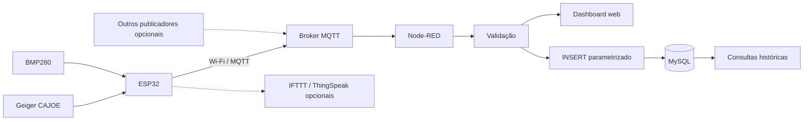

# ESP32 Radiation and Sensors

Estação IoT para monitorização da radiação e de sensores ambientais, aquisição
contínua num ESP32, transmissão MQTT, visualização em Node-RED e armazenamento
histórico em MySQL.

## Arquitetura



O MQTT desacopla a estação de aquisição do servidor. O Node-RED recebe,
valida e encaminha cada observação para o dashboard e para a base de dados.
O dashboard mostra dados recebidos em tempo real; o MySQL guarda o histórico.
O fluxo não recarrega automaticamente o histórico MySQL no dashboard.

## Conteúdo do repositório

| Caminho | Finalidade |
|---|---|
| [firmware/ArduinoGeigerCounterMix/](firmware/ArduinoGeigerCounterMix/) | Firmware ESP32 V1.4.1 (Geiger e BMP280) |
| [HardwareConfig.h](firmware/ArduinoGeigerCounterMix/HardwareConfig.h) | Seleção dos módulos instalados, ecrã e GPIOs |
| [credentials.example.h](firmware/ArduinoGeigerCounterMix/credentials.example.h) | Modelo de configuração, sem credenciais reais |
| [node-red/flows.json](node-red/flows.json) | 17 entradas de medições, 16 gráficos, 6 indicadores de estado e persistência |
| [database/schema.sql](database/schema.sql) | Criação da base de dados e das 17 tabelas |
| [database/queries.sql](database/queries.sql) | Exemplos de consultas históricas |
| [docs/architecture.md](docs/architecture.md) | Ligações, tópicos, tabelas e frequência |
| [tests/validate-flow.js](tests/validate-flow.js) | Testes locais do fluxo e do contrato SQL |

## Instalação

### 1. ESP32

1. Abrir `firmware/ArduinoGeigerCounterMix/ArduinoGeigerCounterMix.ino` no Arduino IDE.
2. Instalar o suporte de placas Arduino-ESP32 e as bibliotecas PubSubClient,
   Adafruit BMP280 e Adafruit BusIO/Unified Sensor. SSD1306 (ThingPulse),
   IFTTTWebhook e ThingSpeak são opcionais.
3. Copiar `credentials.example.h` para `credentials.h`. Preencher o SSID,
   a palavra-passe, endereço e porta do broker MQTT. Ativar serviços externos
   apenas se forem configurados no HardwareConfig.h.
4. Confirmar o modelo de placa, as ligações e a tensão dos sinais antes de
   compilar e carregar. O exemplo usa GPIO16 para Geiger, GPIO22 para LED,
   GPIO0 (SDA) e GPIO4 (SCL) para BMP280.
5. Abrir o monitor série a 115200 baud.

### Configuração modular do hardware

Editar apenas [HardwareConfig.h](firmware/ArduinoGeigerCounterMix/HardwareConfig.h)
e recompilar/carregar o firmware. Cada opção aceita 1 (ativado) ou 0 (desativado).

| Opção | Predefinição | Efeito de desligar |
|---|---:|---|
| ENABLE_GEIGER | 1 | Sem interrupção Geiger, CPM, CPH nem alertas de radiação |
| ENABLE_BMP280 | 1 | Sem acesso ao sensor nem publicação de temperatura, pressão e altitude |
| ENABLE_LCD | 0 | Sem inicialização nem biblioteca OLED |
| ENABLE_LED | 1 | Sem configurar o GPIO nem subscrever comandos do LED |
| ENABLE_IFTTT | 0 | Sem alertas HTTP |
| ENABLE_THINGSPEAK | 0 | Sem publicação ThingSpeak |

O I²C só é inicializado quando BMP280 ou OLED está ativado. O Geiger
desativado também desativa os dependentes IFTTT/ThingSpeak.
Se o BMP280 ou OLED estiver ativado mas não responder, assinala-se
unavailable e tenta-se novamente periodicamente. Sem comunicação física
de diagnóstico, o Geiger não consegue distinguir uma remoção de um período
sem impulsos: desativá-lo explicitamente se for retirado.
O OLED pode mostrar CPM, ou temperatura se apenas o BMP280 estiver ativo.

As flags não são comandos de rede; requerem recompilação. Valores antigos
das flags em credentials.h têm precedência por compatibilidade: removê-los
desse ficheiro para gerir tudo pelo HardwareConfig.h.
Para quem usava IFTTT na V1.4.0, ativar ENABLE_IFTTT=1 com as credenciais válidas.
O dashboard indica o estado dos módulos, sem guardar os estados nas tabelas
numéricas. Um histórico antigo pode continuar visível no gráfico até sair
da janela temporal; não são inseridos zeros artificiais.

### 2. Broker MQTT

Disponibilizar um broker compatível com MQTT 3.1.1 (por exemplo Eclipse
Mosquitto) acessível ao ESP32 e ao Node-RED. Configurar o mesmo endpoint,
porta, autenticação e prefixo de tópicos nos dois clientes. A porta TCP em
exemplo é 1883; a instalação real pode utilizar outra porta.

O firmware usa `esp32/` por defeito. O fluxo espera esse prefixo. Se for
alterado, atualizar todos os tópicos correspondentes no Node-RED.

### 3. MySQL

Criar o esquema de raiz numa instância MySQL ou MariaDB compatível:

```sh
mysql -u ADMIN -p < database/schema.sql
```

Criar separadamente um utilizador dedicado para o Node-RED com privilégios
mínimos (INSERT nas tabelas do esquema; SELECT apenas se forem necessárias
consultas históricas). Nunca executar o Node-RED como administrador MySQL.
Em instalações já existentes, fazer backup e verificar as definições das
tabelas antes de aplicar o esquema: CREATE IF NOT EXISTS não as migra.

### 4. Node-RED

No diretório de utilizador do Node-RED, normalmente `~/.node-red`, instalar
os módulos do fluxo enviado:

```sh
npm install node-red-contrib-stackhero-mysql node-red-dashboard
```

Reiniciar o Node-RED, abrir o editor (normalmente
`http://localhost:1880`), importar [flows.json](node-red/flows.json) e
configurar os dois nós de configuração MQTT e MySQL (os hosts exportados
são placeholders locais). Introduzir os utilizadores e palavras-passe
no editor, testar as ligações e fazer **Deploy**.

O dashboard legado fica normalmente em `http://localhost:1880/ui`.
O módulo `node-red-dashboard` está descontinuado; foi mantido para preservar
a compatibilidade com os gráficos do fluxo original. Uma migração futura
pode usar FlowFuse Dashboard, mas exige converter os nós de interface.

### 5. Verificar ponta a ponta

- No monitor série, confirmar mensagens CPM e BMP280, sem erros de MQTT.
- Confirmar no Node-RED que os nós MQTT estão ligados e os gráficos recebem
  valores. Esperar 15 s para CPM, 60 s para BMP280 e uma hora para CPH.
- Confirmar que as tabelas recebem novas linhas (ver queries.sql).
- Para verificar apenas a configuração Node-RED, publicar uma amostra
  identificada como teste num broker de desenvolvimento, por exemplo:

```sh
mosquitto_pub -h localhost -p 1883 -t esp32/cpm -m 42.0
```

Não usar amostras simuladas na base de dados de produção.

## Notas de segurança e limitações

- Não publicar credenciais de Wi-Fi, MQTT, MySQL, IFTTT ou ThingSpeak.
  O ficheiro credentials.h e as credenciais exportadas de Node-RED são ignorados.
- MQTT e MySQL sem TLS só devem ser usados numa rede isolada; restringir acesso
  ao broker, à base de dados, ao editor e ao dashboard. Para ligação remota,
  configurar transporte protegido, autenticação e controlo de acesso.
- Os sensores adicionais do fluxo (GPS, humidade, campo magnético, tensão,
  sensores internos) não são adquiridos pelo firmware V1.4.1 incluído.
  Os gráficos ficam vazios até existirem publicadores compatíveis.
- O instante da base de dados é UTC de receção, não o instante físico da
  medição. Dados CPH acumulados e reenviados após falha de rede ficam com
  o instante de chegada. Não existe entrega garantida ou buffer persistente
  após perda de alimentação (MQTT QoS 0 e filas em RAM).
- CPM/CPH não são dose em µSv/h. O alarme é indicativo e não substitui
  instrumentação de proteção radiológica calibrada.

## Testes

```sh
node tests/validate-flow.js
```

Valida ligações e identificadores, as 17 funções SQL, payloads válidos e
inválidos e correspondência de tabelas e colunas. Não substitui testes
com ESP32, broker, Node-RED e MySQL reais.

O firmware preserva a atribuição MIT do código original de Hans Carlos
Hofmann, baseado no trabalho de Andreas Spiess e Mark A. Heckler.
