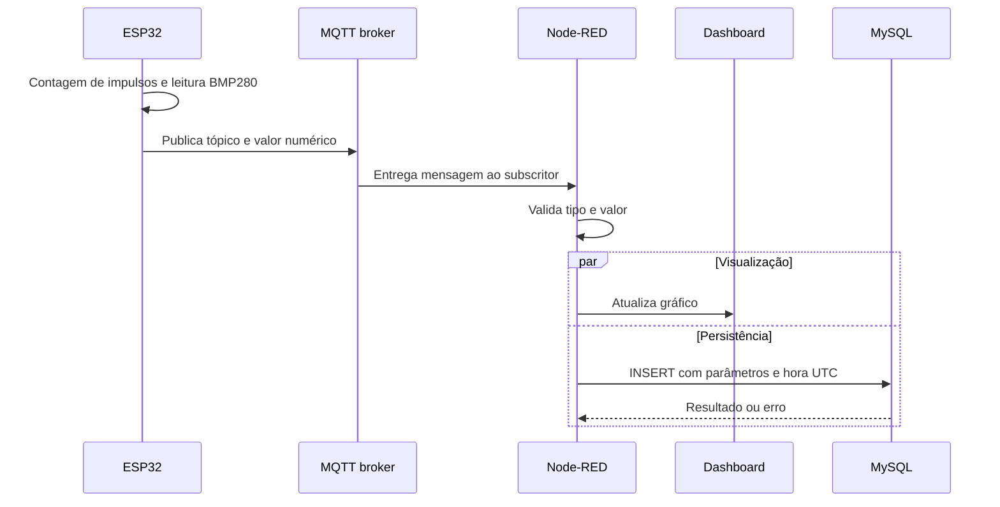
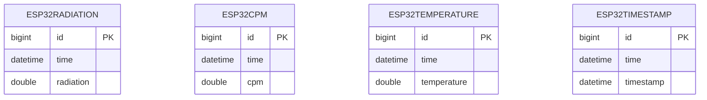

# Arquitetura e contrato de dados

## Funcionamento

As tarefas de comunicação do ESP32 são independentes da aquisição. O
MQTT reconecta sem bloquear a contagem do Geiger. O CPH é normalizado
para 3600000 ms e o CPM para 60000 ms, usando o tempo real de cada janela.
Até 24 resultados CPH por publicar ficam em fila na RAM.

O fluxo original de produção fornecido tinha 16 entradas, 15 gráficos,
e uma saída comum de escrita MySQL. A revisão preserva os 16 tópicos,
os nomes das tabelas e as ligações funcionais, adiciona CPM, validação
de payloads, instruções SQL parametrizadas, diagnóstico de erros e
configurações de servidores sem endereços privados.

## Ligações físicas

| Função | GPIO | Nota |
|---|---:|---|
| Geiger CAJOE — saída de impulsos | 13 | Interrupção FALLING; confirmar nível lógico compatível 3,3 V |
| LED | não atribuído | Desativado; GPIO22 reservado para SCL |
| I²C SDA | 21 | BMP280, AHT, HMC5883L, OLED |
| I²C SCL | 22 | Barramento I²C a 100 kHz |
| OLED opcional | 21 / 22 | Mesmo I²C; endereço 0x3c |
| GPS RX / TX | 16 / 17 | UART2 a 9600 baud; cruzar TX/RX do módulo |
| ADC tensão | 34 | Só entrada; verificar divisor resistivo e calibração |
| LoRa SCK / MISO / MOSI | 5 / 19 / 27 | SPI |
| LoRa SS / RST / DIO0 | 18 / 14 / 26 | Opcional; frequência original 433 MHz a confirmar |

Os endereços BMP280 suportados são 0x76 e 0x77. O módulo BMP280 mede
temperatura e pressão; a altitude é estimada a partir da pressão,
assumindo 1013,25 hPa ao nível do mar. Não mede humidade.

## Tópicos MQTT e tabelas

| Tópico (prefixo esp32/) | Unidade / significado | Tabela | Coluna de valor | Firmware incluído |
|---|---|---|---|---|
| temperature | °C, BMP280 | ESP32TEMPERATURE | temperature | 60 s |
| pressure | hPa | ESP32PRESSURE | pressure | 60 s |
| radiation | CPH | ESP32RADIATION | radiation | 3600 s |
| cpm | CPM | ESP32CPM | cpm | 15 s |
| approxaltitude | m | ESP32APPROXALTITUDE | approxaltitude | 60 s |
| voltage | V, calibração a confirmar | ESP32VOLTAGE | voltage | opcional, 60 s |
| humidity | % | ESP32HUMIDITY | humidity | AHT, 60 s |
| temphum | °C | ESP32TEMPHUM | temphum | AHT, 60 s |
| lat_dd | graus decimais | ESP32LAT_DD | lat_dd | GPS, 60 s |
| lon_dd | graus decimais | ESP32LON_DD | lon_dd | GPS, 60 s |
| timestamp | UTC ISO 8601 com Z | ESP32TIMESTAMP | timestamp | NTP, 60 s |
| magx | µT | ESP32MAGX | magx | opcional, 60 s |
| magy | µT | ESP32MAGY | magy | opcional, 60 s |
| magz | µT | ESP32MAGZ | magz | opcional, 60 s |
| magangle | graus, orientação aproximada | ESP32MAGANGLE | magxangle | opcional, 60 s |
| hall | leitura bruta assinada | ESP32HALL | hall | opcional, core 2.x |
| inttemp | temperatura interna °C, diagnóstico | ESP32INTTEMP | intTemp | opcional, 60 s |

Os nomes `magxangle` e `intTemp` seguem as consultas originais.
GPIOs e modelos foram recuperados do sketch esp32_v6, ainda a confirmar
no equipamento físico. As tabelas SQL não precisam de migração para esta versão.
O timestamp do sensor é guardado como valor próprio; não está associado
automaticamente a mensagens MQTT de outros tópicos.

## Configuração e estado dos módulos

O ficheiro [HardwareConfig.h](../firmware/ArduinoGeigerCounterMix/HardwareConfig.h)
permite desligar cada módulo sem alterar
o código de aquisição. Mudanças nas flags exigem recompilação e carregamento.
GPIOs e endereço OLED são também centralizados.

| Tópico de estado | Valores publicados |
|---|---|
| esp32/status | online / offline |
| esp32/geiger/status | enabled / disabled |
| esp32/bmp280/status | ok / unavailable / disabled |
| esp32/lcd/status | ok / unavailable / disabled |
| esp32/output/state | on / off / disabled |
| esp32/alarm | on / off / disabled |
| esp32/aht/status | ok / unavailable / disabled / waiting / stale |
| esp32/voltage/status | ok / unavailable / disabled / waiting / stale |
| esp32/gps/status | ok / no_fix / unavailable / disabled / waiting / stale |
| esp32/ntp/status | ok / waiting / disabled / stale |
| esp32/mag/status | ok / unavailable / disabled / waiting / stale |
| esp32/lora/status | ok / unavailable / disabled / waiting / stale |
| esp32/hall/status | ok / unsupported / disabled / waiting / stale |
| esp32/inttemp/status | ok / unavailable / unsupported / disabled / waiting / stale |

O Node-RED mostra estes 14 estados em grupos próprios; não são escritos
nas tabelas numéricas. Estados são retidos no broker e devem ser
interpretados em conjunto com online/offline. enabled no Geiger significa
configurado, não prova de presença física. O comando esp32/output
(on/off) só é subscrito quando o LED estiver ativado.
O BMP280 tenta recuperar a cada 30 s e o OLED verifica a presença a
cada 15 s. Os módulos adicionais são lidos a cada 60 s, com verificações
de disponibilidade e sem loops infinitos por falta física. GPS é drenado
continuamente e NTP é iniciado após ligação Wi-Fi. As amostras de módulos
adicionais com mais de 90 s não são publicadas como atuais.

## Base de dados

Cada tabela contém um ID incremental, hora de receção UTC com
milissegundos e a coluna específica de medição. Valores numéricos
usam DOUBLE; o timestamp usa DATETIME(3). O índice em time facilita
consultas por período e o ID permite armazenar várias observações no
mesmo instante. Não existe associação uma-a-uma entre tabelas.

Estas quatro tabelas exemplificam o padrão; as restantes 13 têm a
mesma estrutura numérica, mantendo as colunas indicadas acima.
Não há chaves estrangeiras nem joins obrigatórios entre medições.
As consultas parametrizadas usam a API do
[node-red-contrib-stackhero-mysql](https://github.com/stackhero-io/node-red-contrib-stackhero-mysql).

## Observabilidade

- Node-RED: nós Debug por tópico, resultado MySQL e captura de erros.
- Dashboard web: 16 gráficos originais e 16 novos gráficos V1.6,
  janela de 24 h para radiação/CPM e novos gráficos. A janela é apenas da interface.
- V1.6: [contrato adicional de estatísticas e diagnósticos](geiger-v16.md),
  sete tópicos e três novas tabelas, sem modificar o contrato legado.
- MySQL: histórico enquanto a política de retenção do servidor o permitir.
- IFTTT: alerta opcional aos 200 CPM, rearme abaixo de 100 CPM.
- Perdas MQTT, duplicados e reenvios não são deduplicados sem um ID
  de amostra persistente.

## Privacidade

Latitude e longitude podem revelar a localização da estação. Não
expor o dashboard, o broker nem o histórico GPS publicamente.
O repositório não contém credenciais ou configuração de rede real.
